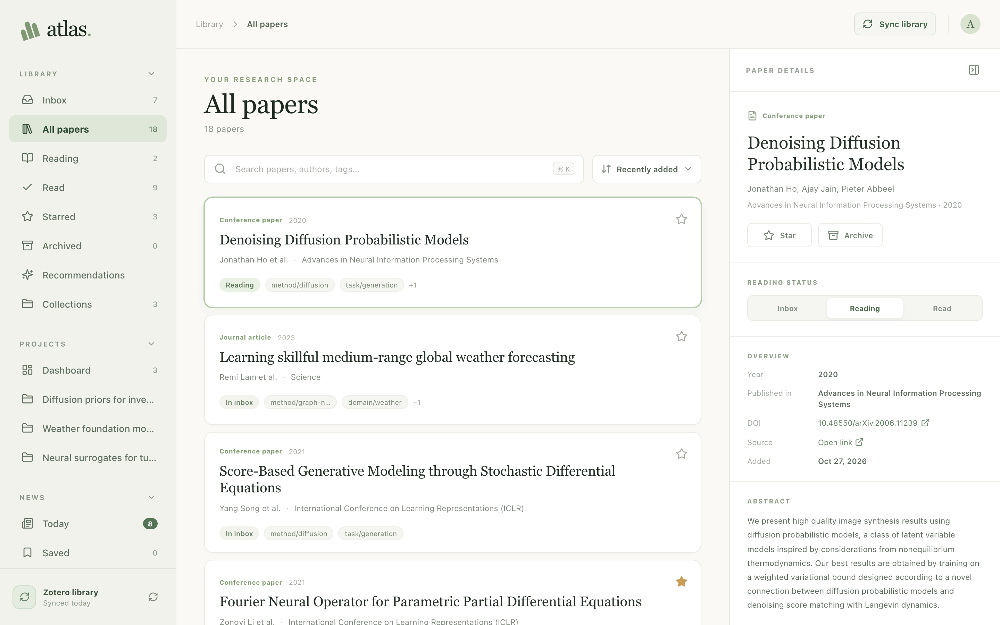
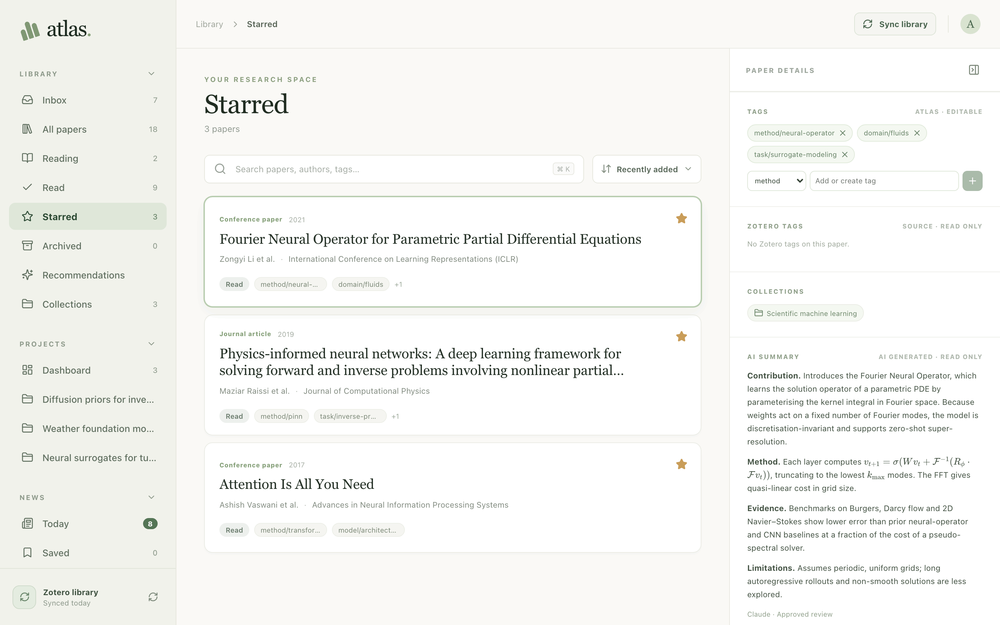
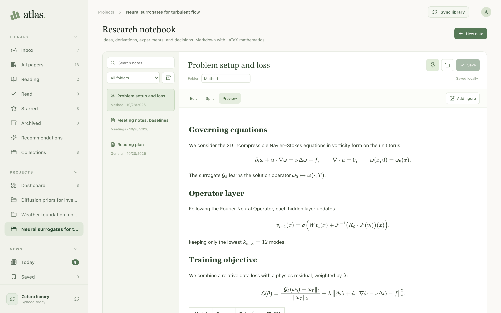
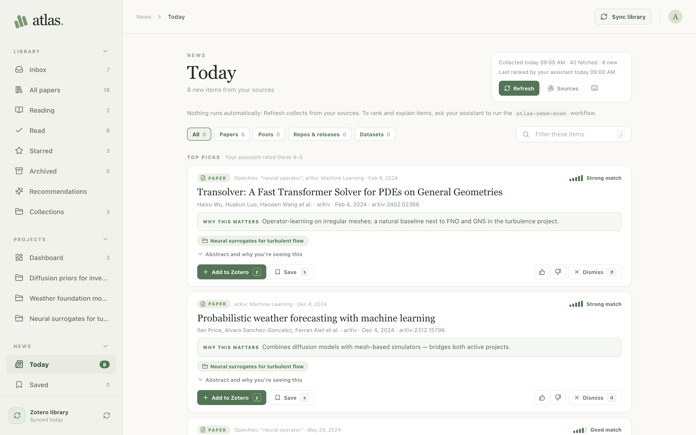
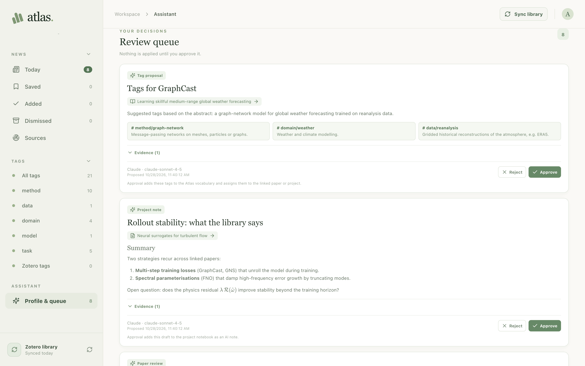

# Atlas

[](https://github.com/nmucke/atlas/actions/workflows/ci.yml)
[](https://github.com/nmucke/atlas/actions/workflows/dependency-audit.yml)
[](https://nodejs.org/)
[](LICENSE)

Atlas is a local web app for researchers that sits on top of your [Zotero](https://www.zotero.org/) library. It adds a reading queue, your own tags, project workspaces with LaTeX-capable notes, and a News feed from sources you choose.

You can also connect Claude or ChatGPT through MCP. The assistant can review papers and propose tags, recommendations and notes, and you approve every proposal in Atlas. Everything is stored on your computer; Atlas needs no cloud account.

Atlas is early software under active development.



## Features

- **Library:** browse Zotero papers in Inbox, Reading, Read, Starred and Archived views; search, filter by collection or tag; keep summaries, notes and page-linked PDF notes.
- **Tags:** your own tag vocabulary with short descriptions, kept separate from Zotero tags.
- **Projects:** link papers, write Markdown notes with KaTeX maths and figures, and export a BibTeX file for Overleaf.
- **News:** collect new papers, posts and releases from arXiv categories, feeds, GitHub repositories and OpenAlex, only when you press Refresh.
- **AI assistant:** eight research workflows over MCP (paper reviews, reading recommendations, project references, research notes, News triage, and more). Every result is a proposal you approve or reject.
- **Local-first:** a SQLite database on your machine. PDFs stay in Zotero.

See [docs/usage.md](docs/usage.md) for a fuller tour.

## Screenshots

The screenshots use demo data: public machine-learning papers with invented tags, projects and notes.

| Paper details                                                                      | Project notes                                                                           |
| ---------------------------------------------------------------------------------- | --------------------------------------------------------------------------------------- |
|  |  |
| Atlas tags, collections and an approved AI summary for a paper.                    | A project notebook rendering Markdown with KaTeX maths.                                 |
| **News**                                                                           | **Assistant review queue**                                                              |
|    |         |
| New items from your sources, ranked by the assistant with a short explanation.     | AI proposals wait for your approval before they change anything.                        |

## Requirements

| Software                                                                | Version     | Needed for                                                                                                          |
| ----------------------------------------------------------------------- | ----------- | ------------------------------------------------------------------------------------------------------------------- |
| [Node.js](https://nodejs.org/) (includes npm)                           | 24 or newer | Running Atlas                                                                                                       |
| [Git](https://git-scm.com/downloads)                                    | any         | Downloading and updating Atlas                                                                                      |
| [Zotero](https://www.zotero.org/download/) desktop                      | 7 or newer  | Library sync and opening PDFs                                                                                       |
| Zotero with the local write API                                         | 10 or newer | Optional: Add to Zotero, attaching PDFs, trashing duplicates (see [Zotero integration](docs/zotero-integration.md)) |
| [Better BibTeX](https://retorque.re/zotero-better-bibtex/installation/) | current     | Optional: BibTeX export only                                                                                        |
| Claude Desktop, Claude Code, or ChatGPT Desktop/Codex                   | current     | Optional: the AI assistant                                                                                          |

Atlas runs on macOS, Linux and Windows. The repository includes an `.nvmrc`, so with [nvm](https://github.com/nvm-sh/nvm) you can run `nvm install && nvm use` to get the right Node version.

## Quick start

1. Download Atlas and install its dependencies:

   ```sh
   git clone https://github.com/nmucke/atlas.git && cd atlas
   npm ci
   ```

2. Build and start it:

   ```sh
   npm run build
   npm start
   ```

3. Open [http://127.0.0.1:3210](http://127.0.0.1:3210).
4. In Zotero, enable **Settings → Advanced → Allow other applications on this computer to communicate with Zotero**.
5. In Atlas, click **Sync library** in the sidebar. Your Zotero papers appear in **Library → Inbox**.

Leave the terminal running while you use Atlas; press Ctrl+C to stop it.

For development, `npm run dev` starts the same server with live reloading and needs no build step.

## Set up Zotero

1. Install [Zotero 7 or newer](https://www.zotero.org/download/) and keep it running while you sync or read PDFs.
2. Turn on the local API: **Settings → Advanced → Allow other applications on this computer to communicate with Zotero**. Atlas connects to it at `127.0.0.1:23119`.
3. Click **Sync library** in Atlas. Sync is manual; click it again after you change things in Zotero. Your Atlas notes, tags and reading status are never overwritten by a sync.
4. Make sure PDFs are downloaded to this computer in Zotero. Atlas opens them from Zotero's storage and does not copy them.
5. Optional: install [Better BibTeX](https://retorque.re/zotero-better-bibtex/installation/) to use **Export BibTeX** in projects.
6. Optional, for write features: in **Assistant → Zotero actions** (or News), click **Enable Zotero writes** and choose **Always Allow** in Zotero. This permission lasts until Atlas restarts.

When Zotero is closed, Atlas still shows your last synced library.

## Connect an AI assistant

Atlas does not call any AI model itself. You connect a desktop assistant that you already use, and it talks to Atlas through a local [MCP](https://modelcontextprotocol.io/) bridge.

1. Start Atlas (`npm start` or `npm run dev`) and keep it running.
2. In a second terminal in the Atlas folder, register Atlas with your assistants:

   | System                           | Command                                     |
   | -------------------------------- | ------------------------------------------- |
   | macOS, Linux                     | `./scripts/register-mcp.sh [workspace-dir]` |
   | Windows (works everywhere)       | `npm run assistant:register`                |
   | Without Claude Code registration | `npm run assistant:setup`                   |

3. Restart Claude Desktop and/or ChatGPT Desktop. In ChatGPT, type `/mcp` to check the connection; in Claude Code, run `claude mcp list`.
4. In Atlas, open **Assistant** and click **Rebuild index** so the assistant can search your library and PDFs.
5. Ask your assistant, for example: _"Use Atlas's profile-and-tags workflow to propose a research profile and tag vocabulary based on my interests: …"_. Approve or reject the result in **Assistant → Review queue**.

**What registration changes.** Existing settings are merged, not replaced, and every changed file is backed up beside the original first.

| Where                                                                                                                                                          | What                                                                  |
| -------------------------------------------------------------------------------------------------------------------------------------------------------------- | --------------------------------------------------------------------- |
| `~/.codex/config.toml` (or `$CODEX_HOME/config.toml`)                                                                                                          | An `atlas` entry for ChatGPT Desktop and Codex                        |
| Claude Desktop config: `~/Library/Application Support/Claude/claude_desktop_config.json` (macOS), `%APPDATA%\Claude\…` (Windows), `~/.config/Claude/…` (Linux) | An `atlas` entry                                                      |
| Claude Code (only if the `claude` CLI is installed)                                                                                                            | A user-scope `atlas` server                                           |
| `<data dir>/assistant-workspace` (or the folder you pass)                                                                                                      | A private workspace with `AGENTS.md`, the workflow skills and configs |

The ChatGPT and Claude Desktop entries are written even if those apps are not installed. Re-run registration after you change your Node version, move the Atlas folder, or change `ATLAS_PORT` or `ATLAS_DATA_DIR`.

Run Codex or Claude Code from the assistant workspace folder so they pick up the instructions and skills. Details, privacy notes and per-host instructions are in [Assistant setup](docs/assistant-setup.md); the workflows are described in [Assistant workflows](docs/assistant-workflows.md).

## Everyday use

- **Read and triage:** new papers land in **Inbox**. Set a status (Inbox, Reading, Read), star or archive, and write a summary and notes. Page-linked notes in the PDF reader are stored in Atlas, not drawn onto the PDF.
- **Tag:** add Atlas tags on a paper or under **Tags**. Prefixes such as `method/`, `data/`, `domain/`, `model/` and `task/` group tags into categories.
- **Projects:** open **Projects**, link papers, write notes (Markdown with `$…$` and `$$…$$` maths), and click **Export BibTeX** to download a `.bib` file for Overleaf.
- **News:** add sources in **News → Sources** (paste an arXiv category such as `stat.ML`, a URL, a GitHub repository, an OpenAlex author, or keywords), then press **Refresh**. OpenAlex and keyword sources need a free OpenAlex API key, set in News → Sources.
- **Assistant proposals:** review AI reviews, tags, recommendations and notes in **Assistant**. AI work is always labelled and kept apart from your own text. **Library → Recommendations** lists papers by the assistant's reading score.

More detail is in [docs/usage.md](docs/usage.md).

## Configuration

| Variable                | Default          | Purpose                                                    |
| ----------------------- | ---------------- | ---------------------------------------------------------- |
| `ATLAS_PORT`            | `3210`           | Port for the web app (1024–65535)                          |
| `ATLAS_DATA_DIR`        | see below        | Where Atlas keeps its database and private files           |
| `CODEX_HOME`            | `~/.codex`       | Location of the ChatGPT Desktop/Codex config used by setup |
| `CLAUDE_DESKTOP_CONFIG` | platform default | Path to Claude Desktop's config file, used by setup        |

Default data directory:

- macOS: `~/Library/Application Support/Atlas`
- Linux: `$XDG_DATA_HOME/atlas`, or `~/.local/share/atlas`
- Windows: `%LOCALAPPDATA%\Atlas`

Use the same `ATLAS_PORT` and `ATLAS_DATA_DIR` when starting Atlas and when registering the assistant.

## Data, privacy and backup

- Atlas listens only on `127.0.0.1`. Do not expose its port to a network.
- Your notes, tags, projects, figures, AI proposals and the search index live in `atlas.sqlite` in the data directory. PDFs stay in Zotero.
- When you use a cloud assistant (Claude, ChatGPT), the excerpts it retrieves from Atlas are sent to that provider. Local storage does not mean a local model.
- News and paper discovery contact arXiv, OpenAlex, Crossref and the feeds you add, sending only source names and search terms.
- To back up, stop Atlas and copy the data directory. Back up Zotero's storage separately.

## Updating

```sh
git pull
npm ci
npm run build
```

Then restart Atlas and restart your assistant apps' MCP connection. Database upgrades run automatically on start, so back up the data directory first. Re-run assistant registration if your Node version or the Atlas folder changed.

## Troubleshooting

| Problem                                                     | Fix                                                                                                                             |
| ----------------------------------------------------------- | ------------------------------------------------------------------------------------------------------------------------------- |
| `npm ci` fails with `EBADENGINE`, or Node.js 24 is required | Install Node 24 (`nvm install && nvm use`), then `npm ci` again.                                                                |
| `npm start` says to run `npm run build` first               | Run `npm run build`, or use `npm run dev`.                                                                                      |
| "Port 3210 is already in use"                               | Another Atlas or app uses 3210. Stop it, or start with `ATLAS_PORT=3211 npm start` and re-run registration with the same value. |
| Sync fails or says Zotero cannot be reached                 | Start Zotero and enable **Allow other applications on this computer to communicate with Zotero** in Settings → Advanced.        |
| A PDF does not open                                         | Keep Zotero running and make sure the file is downloaded in Zotero.                                                             |
| Export BibTeX fails                                         | Install or enable Better BibTeX in Zotero. Missing citation keys or duplicate keys are reported as errors; fix them in Zotero.  |
| Assistant: "Start Atlas with npm start before connecting"   | Atlas is not running, or it uses a different `ATLAS_DATA_DIR` from the one registered. Start it, or re-run registration.        |
| Assistant shows old or missing tools                        | Restart Atlas, then restart the assistant app's MCP connection and open a new chat.                                             |
| News: OpenAlex needs a free API key                         | Add the key in **News → Sources → Settings**.                                                                                   |
| Add to Zotero or PDF attach fails                           | Update Zotero, then click **Enable Zotero writes** again (the permission resets when Atlas restarts).                           |

## Uninstall

1. Stop Atlas.
2. Delete the data directory (see [Configuration](#configuration)). This removes your Atlas notes, tags and projects, and the default assistant workspace. Your Zotero library is not affected.
3. If you registered an assistant, remove the `atlas` entry from `~/.codex/config.toml` and from `claude_desktop_config.json`, and run `claude mcp remove --scope user atlas`. You can also delete the `*.atlas-backup-*` files next to those configs.
4. Delete the Atlas folder.

## Limitations

- Single-user and single-computer; there is no cross-device sync.
- Zotero remains the source of truth for bibliographic data and PDFs; Atlas does not replace it.
- Sync and News collection are manual, never scheduled.
- PDF search has no OCR and is keyword-based, not semantic.
- Features and storage may change while Atlas is in early development.

## Documentation

- [Usage guide](docs/usage.md): library, tags, projects, notes and News in detail
- [Assistant setup](docs/assistant-setup.md): hosts, the local bridge, retrieval and privacy
- [Assistant workflows](docs/assistant-workflows.md): the eight workflows and MCP tools
- [Architecture](docs/architecture.md): data ownership and database schema
- [Zotero integration](docs/zotero-integration.md): API use and compatibility
- [News design](docs/news-design.md): sources, ranking and roadmap

## Contributing

Bug reports and pull requests are welcome. See [CONTRIBUTING.md](CONTRIBUTING.md) for development setup and the checks to run.

## License

[MIT](LICENSE) © Nikolaj T. Mücke
